<div align="center">


<a href="https://about-me-sandy-chi.vercel.app"></a>
<a href="https://www.linkedin.com/in/arhemanth"></a>
<a href="https://github.com/Hemanth05065?tab=repositories"></a>


<br/><br/>




</div>

> 🚩 *I treat every problem like a capture-the-flag: understand the system under the hood, then find the cleanest way through.*
> I build **AI people can rely on**, **hardware that keeps talking when networks fail**, and **software that's safe by design**.


## ⚡ Highlights

<table>
<tr>
<td width="50%" valign="top">

### 📄 Research paper accepted
*Safety and Security of Artificial Intelligence: Addressing Biases, Uncontrolled Autonomy, and Governance Challenges in Autonomous Systems*
<sub>20th International Conference on Webometrics, Informetrics & Scientometrics (WIS) & 25th COLLNET Meeting, Sri Lanka</sub>

</td>
<td width="50%" valign="top">

### 🧾 Patent application filed
A unified framework that audits deployed AI for **bias, adversarial attacks, human-oversight gaps and regulatory compliance**, all in one pass.

</td>
</tr>
<tr>
<td width="50%" valign="top">

### 🏛️ Smart India Hackathon 2026
Built **JANSETU** for problem statement **SIH26043**.

</td>
<td width="50%" valign="top">

### 🚩 CTF host
Hosted the **"Shell Smash"** CTF at my university.

</td>
</tr>
</table>

## 🛠️ Featured work

<table>
<tr>
<td width="50%" valign="top">

### 🔐 [personal-ai](https://github.com/Hemanth05065/personal-ai)
Private assistant on your own PC. The model can only *propose* actions; the server approves, runs and audits them.

**0 unapproved writes in 450 prompt-injection runs.**

 `Ollama` `Pyodide` `OPA`

</td>
<td width="50%" valign="top">

### 🏛️ [JANSETU](https://github.com/Hemanth05065/JANSETU-UPDATED)
SIH 2026: citizens report local problems, an AI classifier routes each to the best-fit university or industry partner, tracked to a confirmed fix.


</td>
</tr>
<tr>
<td width="50%" valign="top">

### 📡 [PoCkEt-CoM](https://github.com/Hemanth05065/PoCkEt-CoM)
Off-grid SOS messenger: phone → Bluetooth → ESP32 → **LoRa radio** → gateway → live dashboard. Works with no cell signal.

 `ESP32` `LoRa SX1278` `GPS`

</td>
<td width="50%" valign="top">

### 🧠 [Synapse HR](https://github.com/Hemanth05065/AI-EMPLOYEE-AND-HR-INTELLIGENCE-PLATFORM-)
HR platform with employee and HR portals, analytics, and Gemini-powered chatbot and missed-punch alerts.

 `Genkit`

</td>
</tr>
</table>


## 🧰 Toolbox

<p align="center">
  
</p>

<sub>**AI / ML:** PyTorch · TensorFlow · scikit-learn · Ollama (local LLMs) · Genkit &nbsp;|&nbsp; **Hardware:** ESP32 · Arduino · LoRa</sub>

## 🎯 Right now

```text
Semester 5 / 8   ██████████████░░░░░░  CGPA 9.52
DSA + Deep Learning roadmap   ▓▓▓▓▓▓▓▓░░░░
Through-line: AI safety · local-first AI
```

## 🐍 Contribution snake

<div align="center">
  <picture>
    <source media="(prefers-color-scheme: dark)" srcset="https://raw.githubusercontent.com/Hemanth05065/Hemanth05065/output/github-snake-dark.svg"/>
    
  </picture>

  
  

  <br/><br/>
  
</div>
